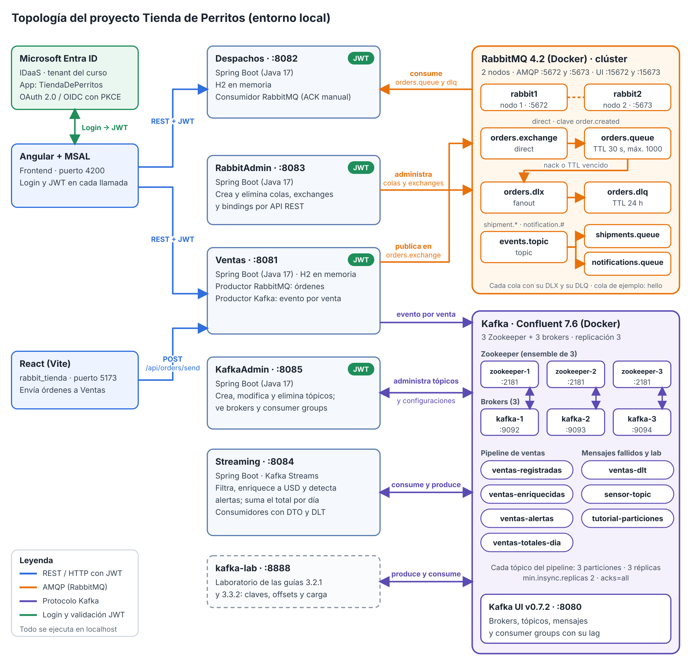

# Tienda de Perritos

**DSY1107 Desarrollo Cloud Native I · Sección 003D · Grupo 6**
Antonia Arjona, Alejandra Reyes y Dante Torres · Profesor: Ricardo Aravena

Sistema de microservicios en Spring Boot con un frontend Angular que inicia sesión con Microsoft Entra ID (IDaaS). La mensajería se reparte en dos flujos: un clúster RabbitMQ de dos nodos para las órdenes de despacho y un clúster Kafka de tres brokers para el streaming y el análisis de ventas.

## Topología



- **Autenticación:** Angular inicia sesión en Entra ID (OAuth 2.0 / OIDC con PKCE) y envía el JWT a Ventas y Despachos. Ventas, Despachos, RabbitAdmin y KafkaAdmin validan el token.
- **RabbitMQ (clúster de 2 nodos):** Ventas publica órdenes en `orders.exchange` (direct) y Despachos las consume desde `orders.queue`. El clúster además trae el exchange `events.topic` (topic) con las colas `shipments.queue` y `notifications.queue`. Cada cola tiene su dead letter exchange y su DLQ.
- **Kafka (3 Zookeeper + 3 brokers):** Ventas publica un evento por cada venta guardada en `ventas-registradas` y Streaming lo procesa con Kafka Streams hacia `ventas-enriquecidas`, `ventas-alertas` y `ventas-totales-dia`. Streaming también consume `ventas-alertas` y `ventas-enriquecidas` con consumer groups propios y envía los mensajes que no puede procesar a `ventas-dlt`.
- **Administración:** RabbitAdmin gestiona colas, exchanges y bindings. KafkaAdmin gestiona tópicos, configuraciones y consumer groups.

## Componentes

| Componente | Carpeta | Puerto | Descripción |
|---|---|---|---|
| Frontend Angular + MSAL | `frontend-tienda-perritos` | 4200 | Login con Entra ID y llamadas a Ventas y Despachos con el JWT |
| Frontend React (órdenes) | `rabbit_tienda` | 5173 | Envía órdenes a Ventas (`POST /api/orders/send`) |
| Ventas | `back-Ventas_SpringBoot/Springboot-API-REST` | 8081 | Ventas, productor RabbitMQ y productor Kafka |
| Despachos | `back-Despachos_SpringBoot/Springboot-API-REST-DESPACHO` | 8082 | Despachos y consumidor RabbitMQ con DLQ |
| RabbitAdmin | `back-RabbitAdmin_SpringBoot/Springboot-API-REST-RABBITADMIN` | 8083 | Crea y elimina colas, exchanges y bindings |
| Streaming | `back-Streaming_SpringBoot/Springboot-API-REST-STREAMING` | 8084 | Pipeline con Kafka Streams, consumidores con DTO y tópico de mensajes fallidos |
| KafkaAdmin | `back-KafkaAdmin_SpringBoot/Springboot-API-REST-KAFKAADMIN` | 8085 | Crea, lista, modifica y elimina tópicos; consulta brokers y consumer groups |
| kafka-lab | `kafka-lab` | 8888 | Laboratorio de las guías 3.2.1 y 3.3.2 |
| Clúster Kafka | `docker/kafka` | 9092, 9093 y 9094 | 3 Zookeeper y 3 brokers |
| Kafka UI | `docker/kafka-ui` | 8080 | Consola de administración del clúster Kafka |
| Clúster RabbitMQ | `docker/rabbitmq-cluster` | 5672, 5673, 15672 y 15673 | 2 nodos con colas, DLQ y exchanges precargados |
| front_despacho | `front_despacho` | - | Frontend React del curso de DevOps, se mantiene como referencia |

## Requisitos

- Java 17 y Maven (los microservicios incluyen el wrapper `./mvnw`; kafka-lab usa `mvn`)
- Node.js 20+ y Angular CLI (`npm install -g @angular/cli`)
- Docker con Compose v2 (el clúster Kafka y el de RabbitMQ juntos necesitan unos 4 GB de RAM libres para Docker)

## Cómo ejecutar

Antes de empezar, detén los compose antiguos si los tenías corriendo, porque usan los mismos puertos que el clúster nuevo: `kafka-lab/compose.yaml` (Kafka en 9092 y Kafka UI en 8080) y `DOCKER-COMPOSE.YML` (RabbitMQ en 5672 y 15672). Usa `docker compose down` en cada uno.

1. Clúster Kafka (3 Zookeeper y 3 brokers):
   ```
   cd docker/kafka
   docker compose up -d
   docker compose ps
   ```
   Los brokers tardan alrededor de un minuto en quedar `healthy`.
2. Kafka UI:
   ```
   cd docker/kafka-ui
   docker compose up -d
   ```
   Se abre en http://localhost:8080.
3. Clúster RabbitMQ (2 nodos):
   ```
   cd docker/rabbitmq-cluster
   docker compose up -d
   ```
   Las consolas están en http://localhost:15672 y http://localhost:15673 (usuario y clave `guest`). El contenedor `rabbitmq-setup` carga las colas, DLQ y exchanges y termina solo.
4. Cada microservicio en su propia terminal. Streaming primero, porque crea los tópicos:
   ```
   cd <carpeta del microservicio>
   ./mvnw spring-boot:run
   ```
5. Laboratorio Kafka (opcional):
   ```
   cd kafka-lab
   mvn spring-boot:run
   ```
6. Frontends:
   ```
   cd frontend-tienda-perritos
   npm install
   ng serve
   ```
   ```
   cd rabbit_tienda
   npm install
   npm run dev
   ```

Kafka tiene desactivada la creación automática de tópicos: Streaming y kafka-lab declaran los suyos en `KafkaTopicsConfig` y los crean al iniciar. Kafka UI también permite crearlos a mano.

## Seguridad con Microsoft Entra ID

- **Tenant:** dsy1107seccion003dAle
- **App registrada:** TiendaDePerritos
- **Scope expuesto:** `access_as_user`
- **Redirect URI (SPA):** `http://localhost:4200`

Ventas, Despachos, RabbitAdmin y KafkaAdmin usan `spring-cloud-azure-starter-active-directory` para validar firma, issuer y audience del token. Los identificadores públicos (client id y app id URI) están en el `application.properties` de cada servicio y en `frontend-tienda-perritos/src/environments/environment.ts`. Streaming y kafka-lab no tienen autenticación porque son de uso de laboratorio.

Para comprobar la validación: `GET http://localhost:8081/api/v1/ventas` sin header `Authorization` responde **401**, y con `Authorization: Bearer <token>` válido responde **200**. Lo mismo vale para `GET http://localhost:8085/api/admin/topics`.

## RabbitMQ

### Clúster de dos nodos

`docker/rabbitmq-cluster` levanta `rabbit1` (AMQP 5672, consola 15672) y `rabbit2` (AMQP 5673, consola 15673). Los nodos se unen con `classic_config` y comparten la cookie de Erlang. Ventas, Despachos y RabbitAdmin usan `spring.rabbitmq.addresses=localhost:5672,localhost:5673`, así que si `rabbit1` no responde el cliente prueba con `rabbit2`.

El contenedor `rabbitmq-setup` importa `definitions.json` por la API HTTP cuando los dos nodos están arriba:

| Elemento | Tipo | Detalle |
|---|---|---|
| `events.topic` | Exchange topic | Enruta por clave con comodines |
| `shipments.queue` | Cola | Binding `shipment.*`, TTL 30 s, máximo 1000 mensajes, DLX `shipments.dlx` |
| `notifications.queue` | Cola | Binding `notification.#`, TTL 30 s, máximo 1000 mensajes, DLX `notifications.dlx` |
| `shipments.dlx` y `notifications.dlx` | Exchange fanout | Reciben los mensajes muertos |
| `shipments.dlq` y `notifications.dlq` | Cola | TTL de 24 h |

Los exchanges `orders.*` (direct) no se precargan: los declara Ventas o Despachos al iniciar, o se pueden crear con RabbitAdmin.

### Flujo de órdenes

- `POST /api/orders/send` en Ventas publica en `orders.exchange` (direct) con la clave `order.created`.
- `orders.queue`: durable, TTL de 30 s, máximo 1000 mensajes y dead letter hacia `orders.dlx` (fanout), que enruta a `orders.dlq` (TTL de 24 h).
- Despachos consume con confirmación manual: si el procesamiento termina bien hace ACK, ante un fallo temporal reintenta una vez, y ante un fallo permanente o un reintento agotado el mensaje va a la DLQ. Un listener de la DLQ deja el registro en los logs.
- RabbitAdmin expone `/api/admin/queues`, `/api/admin/exchanges` y `/api/admin/bindings` (POST crea y DELETE elimina). Los tipos de exchange soportados son DIRECT, FANOUT, TOPIC y HEADERS.

### Limitación del clúster

Con dos nodos, las colas clásicas viven en un solo nodo. Si ese nodo se cae, la cola queda no disponible hasta que vuelva, aunque el otro nodo siga funcionando. Para tener réplicas reales harían falta tres nodos y colas quorum.

## Kafka

### Clúster

`docker/kafka` levanta un ensemble de 3 Zookeeper y 3 brokers (imágenes Confluent 7.6.1):

| Broker | Puerto desde tu máquina | Puerto dentro de la red Docker |
|---|---|---|
| kafka-1 | 9092 | 29092 |
| kafka-2 | 9093 | 29092 |
| kafka-3 | 9094 | 29092 |

Los clientes se conectan con `localhost:9092,localhost:9093,localhost:9094`. La creación automática de tópicos está desactivada y los valores por defecto son 3 particiones y factor de réplica 3. Los tópicos del pipeline llevan `min.insync.replicas=2` y los productores usan `acks=all` con idempotencia, de modo que una escritura confirmada existe en al menos dos brokers.

### Tópicos

| Topic | Uso | Particiones | Réplicas | cleanup.policy | Retención |
|---|---|---|---|---|---|
| `ventas-registradas` | Entrada: la publica Ventas con clave `idVenta` | 3 | 3 | delete | 7 días |
| `ventas-enriquecidas` | Ventas válidas con el monto en USD | 3 | 3 | delete | 7 días |
| `ventas-alertas` | Alertas de detección | 3 | 3 | delete | 30 días |
| `ventas-totales-dia` | Total vendido por fecha (clave = fecha) | 3 | 3 | compact | Se conserva el último total de cada fecha |
| `ventas-dlt` | Mensajes que los consumidores no pudieron procesar | 3 | 3 | delete | 14 días |
| `sensor-topic` | Prueba de carga IoT (guía 3.3.2) | 3 | 1 | delete | 5 minutos o 50 MiB por partición |
| `tutorial-particiones` | Particiones, claves y offsets (guía 3.2.1) | 3 | 1 | delete | Por defecto |

La configuración de un tópico solo se aplica cuando se crea. Si ya existe, hay que recrearlo o modificarlo con KafkaAdmin (`PATCH /api/admin/topics/{name}/config`).

### Pipeline de Streaming

1. Filtra las ventas bajo 1000 CLP.
2. Enriquece cada venta con el monto en USD (tasa simulada de 950 CLP por USD, que no es un tipo de cambio real).
3. Genera alertas: severidad ALTA sobre 500000 CLP y MEDIA si la fecha de compra es futura.
4. Suma el total vendido por día.

Los umbrales y la tasa se leen de `application.yml` (`pipeline.*`). El consumer group de Kafka Streams es `tienda-perritos-streaming`. Un mensaje con JSON inválido se registra en el log y se omite, sin detener el stream. Ventas publica con `acks=all`, idempotencia y `max.block.ms=3000`: si Kafka no responde, la venta ya guardada no se pierde ni se revierte.

### Consumidores con DTO y manejo de errores

Streaming incluye dos consumidores con `@KafkaListener`, cada uno con su consumer group:

| Consumidor | Topic | Group | Qué hace |
|---|---|---|---|
| `AlertasConsumer` | `ventas-alertas` | `alertas-group` | Registra las últimas 50 alertas y cuenta por severidad |
| `VentasEnriquecidasConsumer` | `ventas-enriquecidas` | `analitica-group` | Acumula cantidad de ventas y montos en CLP y USD |

Los mensajes JSON se convierten a los DTO `AlertaVenta` y `VentaEnriquecida` con `ErrorHandlingDeserializer` y `JsonDeserializer`. Si el procesamiento falla, un `DefaultErrorHandler` reintenta 2 veces con 1 segundo de espera; los mensajes no deserializables y los que lanzan `EventoInvalidoException` no se reintentan. Al agotarse los reintentos, el mensaje se publica en `ventas-dlt` y el consumidor sigue con el siguiente. Los resultados se consultan en `GET http://localhost:8084/api/alertas` y `GET http://localhost:8084/api/resumen`.

Para probarlo sin token JWT (solo laboratorio), con Streaming corriendo:
```
cd back-Streaming_SpringBoot/Springboot-API-REST-STREAMING
.\probar-pipeline.ps1
```
El script usa `POST /api/simulador/ventas`. Los resultados se ven en Kafka UI en `http://localhost:8080`.

### KafkaAdmin

Microservicio en el puerto 8085 (requiere JWT) con un cliente `Admin` de Kafka detrás de una fachada (`KafkaAdminService`):

| Método y ruta | Acción |
|---|---|
| `GET /api/admin/topics` | Lista los tópicos |
| `GET /api/admin/topics/{name}` | Particiones, líder, réplicas, ISR y configuración |
| `POST /api/admin/topics` | Crea un tópico (por defecto 3 particiones y 3 réplicas) |
| `PATCH /api/admin/topics/{name}/config` | Modifica o elimina configuraciones |
| `PUT /api/admin/topics/{name}/partitions` | Aumenta las particiones |
| `DELETE /api/admin/topics/{name}` | Elimina el tópico |
| `GET /api/admin/cluster` | Brokers, controlador y clusterId |
| `GET /api/admin/consumer-groups` | Lista los consumer groups |
| `GET /api/admin/consumer-groups/{groupId}` | Miembros, offsets y lag por partición |

Hay ejemplos con `curl` en el README del módulo.

### kafka-lab

- `GET /api/kafka/health` y `POST /api/kafka/send?message=...&key=...` publican en `tutorial-particiones` (grupo `mi-grupo-educativo`).
- `POST /api/test/start?count=N` envía N mensajes a `sensor-topic` (grupo `analytics-group`) y entrega el tiempo y el throughput.
- Los parámetros del productor se cambian con variables de entorno antes de iniciar. Ejemplo del escenario A (`batch.size` 16 KB, sin `linger` y sin compresión) en PowerShell:
  ```
  $env:KAFKA_BATCH_SIZE="16384"
  $env:KAFKA_LINGER_MS="0"
  $env:KAFKA_COMPRESSION="none"
  mvn spring-boot:run
  ```
  Sin variables, el valor por defecto es el del escenario B (32 KB, 20 ms y Snappy).

### Probar la tolerancia a fallos

1. Con todo arriba, revisa en Kafka UI (Topics, `ventas-registradas`) que cada partición tenga 3 réplicas en sincronía.
2. Detén un broker: `docker compose stop kafka-2` dentro de `docker/kafka`.
3. Vuelve a mirar el tópico: el líder de las particiones que estaban en `kafka-2` pasa a otro broker y el ISR queda con 2. Crear ventas y publicar mensajes sigue funcionando, porque `min.insync.replicas=2`.
4. `GET /api/admin/consumer-groups/alertas-group` muestra el lag por partición.
5. Levanta el broker de nuevo con `docker compose start kafka-2` y comprueba que vuelve al ISR.

## Pruebas

Los microservicios incluyen pruebas unitarias: `./mvnw test` (o `.\mvnw.cmd test` en Windows) dentro de cada carpeta: Ventas, Despachos, RabbitAdmin, Streaming y KafkaAdmin.

## Notas de entorno

- Ventas y Despachos usan una base de datos **H2 en memoria**, que se recrea vacía en cada arranque. La consola queda disponible en `/h2-console`.
- Kafka y RabbitMQ corren en Docker con configuración de laboratorio: credenciales `guest/guest` en RabbitMQ, sin TLS ni autenticación en Kafka. No es una configuración para producción.
- Los volúmenes de Docker conservan los datos entre reinicios. Para empezar limpio, `docker compose down -v` dentro de la carpeta correspondiente.

## Estructura del repositorio

- `back-Ventas_SpringBoot/`, `back-Despachos_SpringBoot/`, `back-RabbitAdmin_SpringBoot/`, `back-Streaming_SpringBoot/`, `back-KafkaAdmin_SpringBoot/`: microservicios Spring Boot
- `docker/kafka/`, `docker/kafka-ui/`, `docker/rabbitmq-cluster/`: compose del clúster Kafka, de Kafka UI y del clúster RabbitMQ
- `kafka-lab/`: laboratorio Kafka (su `compose.yaml` es de un solo nodo y no debe correr junto al clúster)
- `frontend-tienda-perritos/`: frontend Angular con MSAL
- `rabbit_tienda/`: frontend React para enviar órdenes a RabbitMQ
- `front_despacho/`: frontend React del curso de DevOps (referencia)
- `DOCKER-COMPOSE.YML`: RabbitMQ de un solo nodo (anterior al clúster)
- `docs/`: diagrama de la topología
